# Pagewell

A cross-platform reading and listening app built with Flutter and Riverpod: an ebook library with a real EPUB reader, audiobook streaming, a searchable reference library, a daily editorial read, bookmarks and favourites, free and Premium membership, and an editor studio that publishes new content to readers.

## Demo

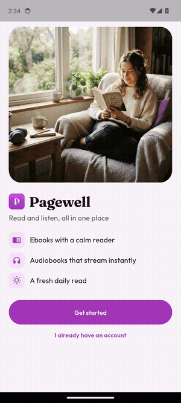

Captured on an Android emulator. The same codebase builds for iOS.

## Screenshots

| Welcome | Sign in | Today | Library |
|---|---|---|---|
|  | 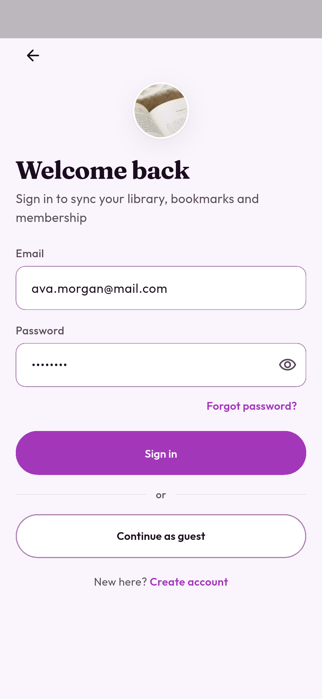 | 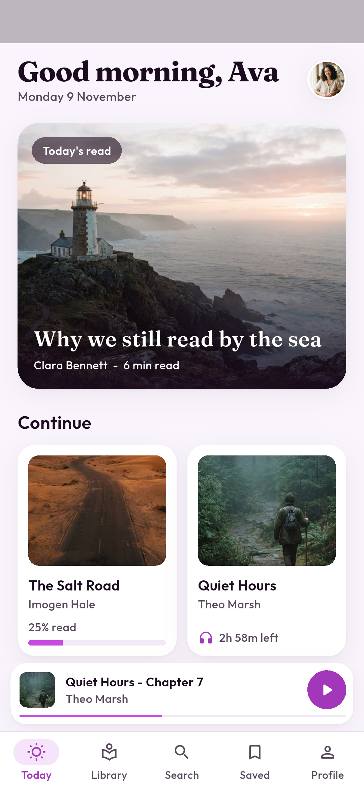 | 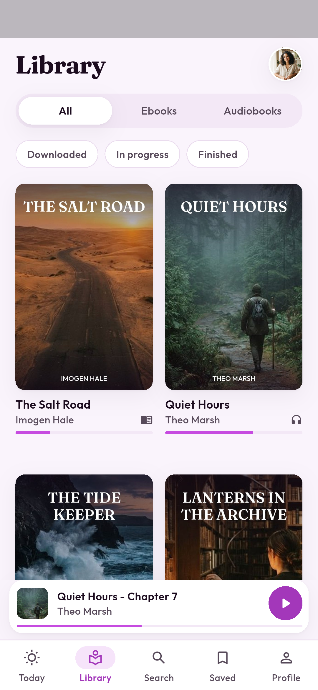 |

| Book detail | EPUB reader | Audiobook player | Search |
|---|---|---|---|
| 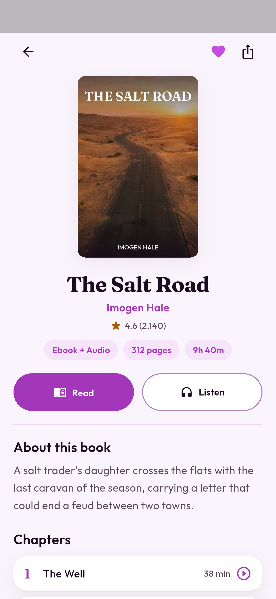 | 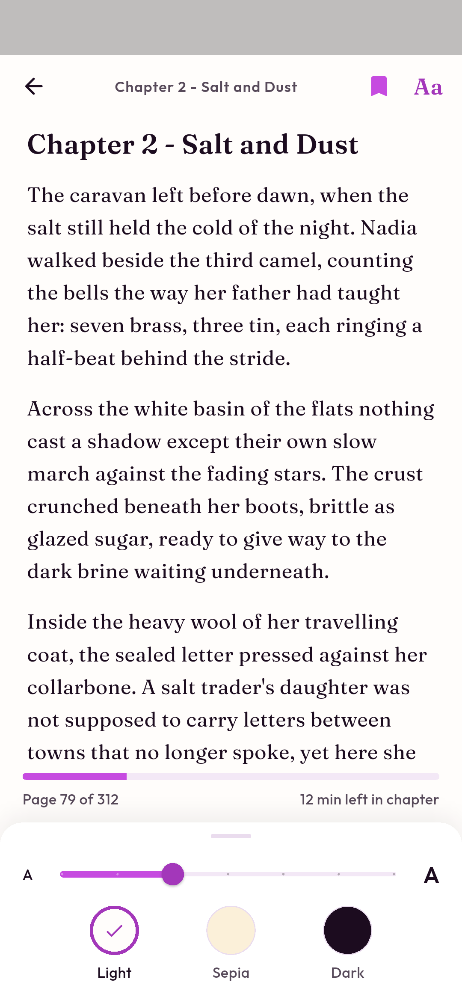 | 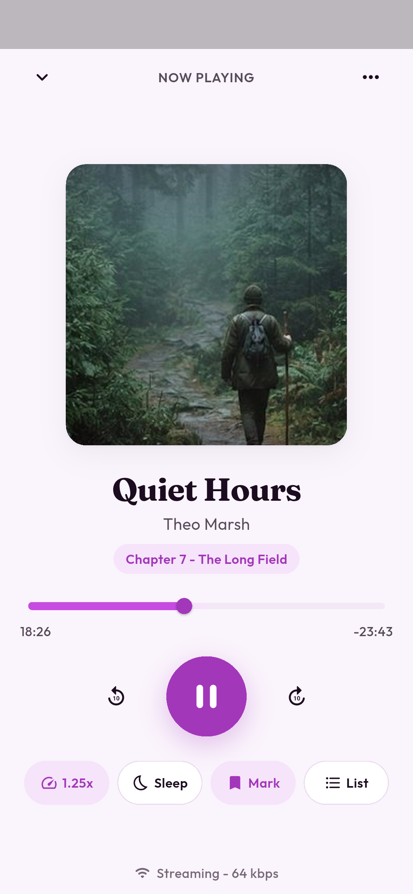 | 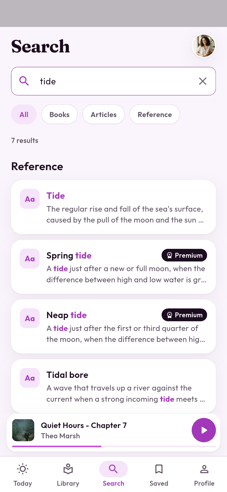 |

| Reference entry | Saved | Profile | Membership |
|---|---|---|---|
| 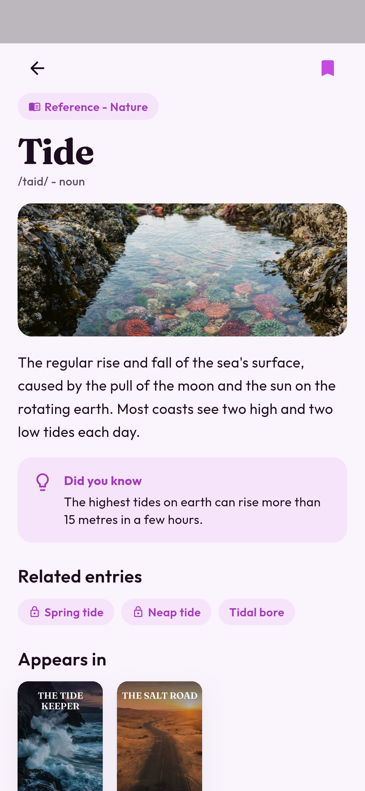 | 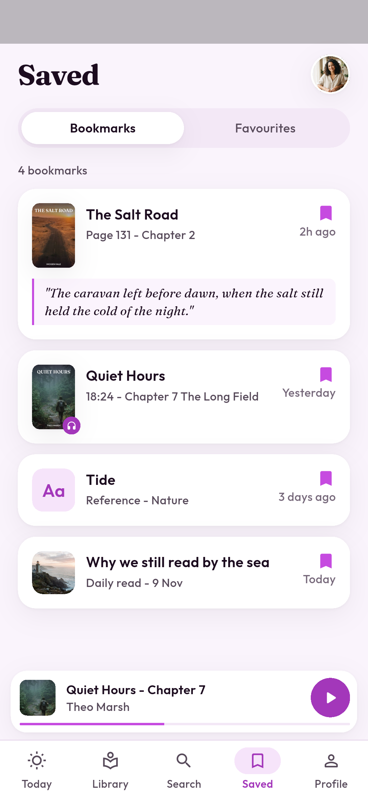 | 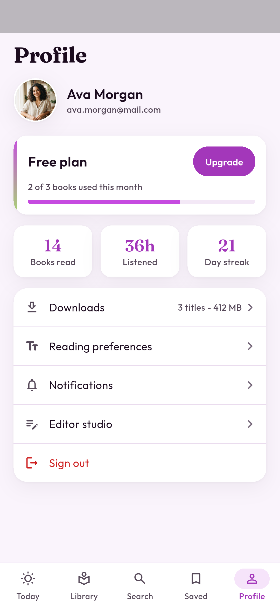 | 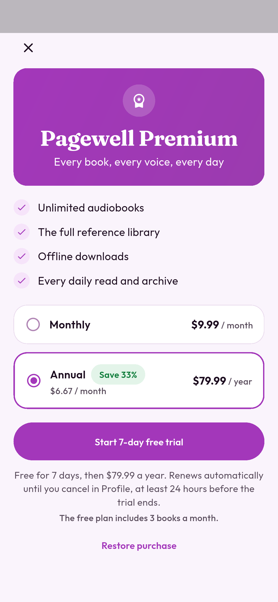 |

| Editor studio | Today after publishing |
|---|---|
| 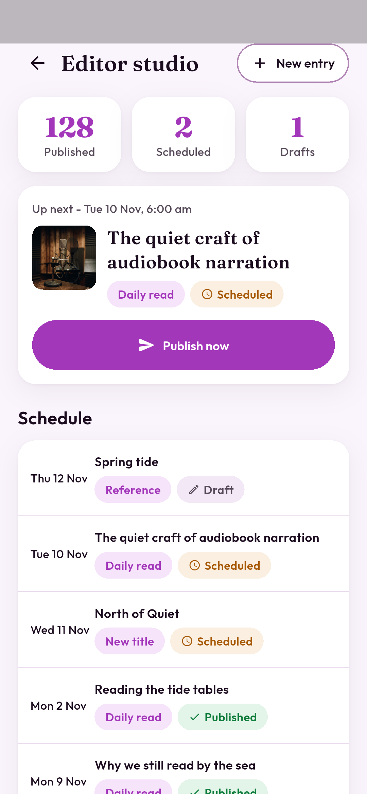 | 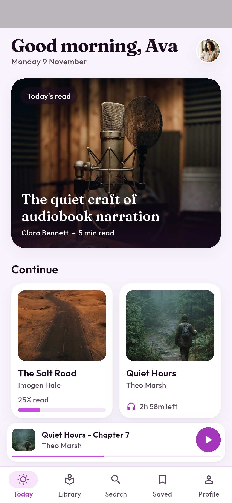 |

## What it shows

- **Ebook library with EPUB support**: the reader opens a real `.epub` file (`assets/books/the-salt-road.epub`). `EpubParser` unzips it, reads `META-INF/container.xml`, follows the OPF manifest and spine, and renders each XHTML chapter as reflowable text. Text size, light/sepia/dark themes, chapter navigation, page count and progress.
- **Audiobook streaming and playback**: a streaming engine with a buffer that runs ahead of playback, 15 second skip, 0.75x to 2x speed, sleep timer, chapter list, scrubber and a mini player that follows you across tabs.
- **Searchable content and reference library**: one index over book metadata, the text inside EPUBs, editorial articles and reference entries, with scope chips (All, Books, Articles, Reference) and highlighted matches.
- **Daily editorial content**: Today leads with the newest published daily read from the CMS feed.
- **Accounts, bookmarks and favourites**: sign in or continue as a guest (empty library state), page and audio bookmarks, reference and article bookmarks, favourite titles.
- **Free and Premium membership**: Premium titles and reference entries are gated; the paywall offers monthly and annual plans with a free trial.
- **Content management**: the editor studio reads the CMS schedule (scheduled, draft, published), and "Publish now" makes tomorrow's piece live on Today straight away.

## App flow

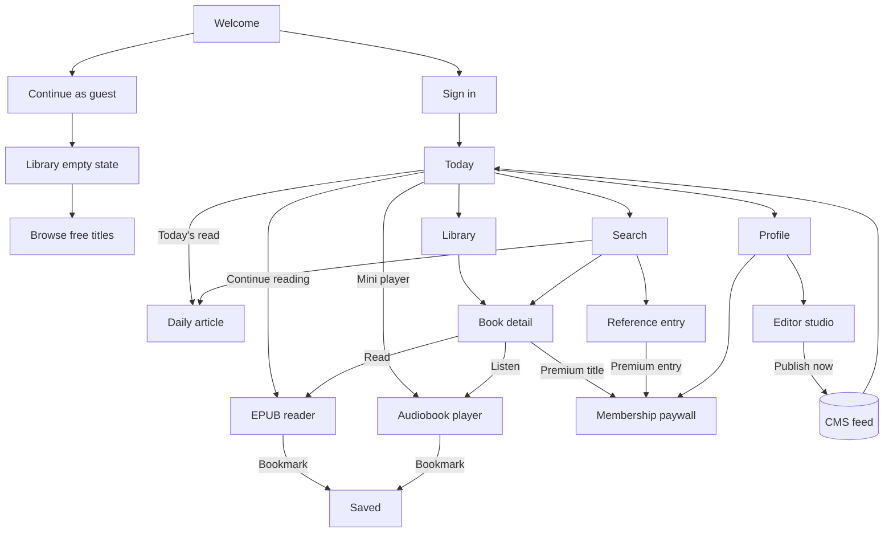

## Architecture

- **Flutter 3.35 + Riverpod 3** (`Notifier` / `AsyncNotifier`), feature folders under `lib/features/`.
- `lib/domain/` plain models (books, chapters, articles, reference entries, bookmarks, CMS entries).
- `lib/data/` the EPUB parser (`archive` + `xml`), catalog and reference data, the in-memory search index, the CMS feed and the streaming audio engine.
- `lib/state/providers.dart` session, membership gating, library, reading position and prefs, bookmarks, favourites, player, CMS and search.
- `lib/app/nav.dart` one place for routes and Premium gating.
- Content is mocked locally so the demo runs offline. In production the catalog, CMS feed and auth come from an API (headless CMS such as Strapi or Sanity, or Firebase), audio streams through `just_audio` with background playback, and purchases go through StoreKit and Play Billing (for example with RevenueCat).

## Run

```sh
flutter pub get
flutter run
flutter test
```

The sample EPUB is generated by `python3 tool/make_epub.py`.
